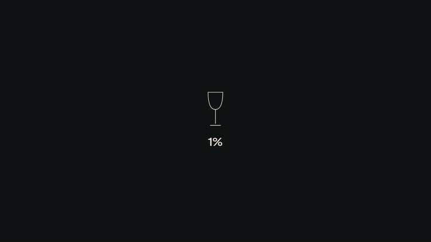
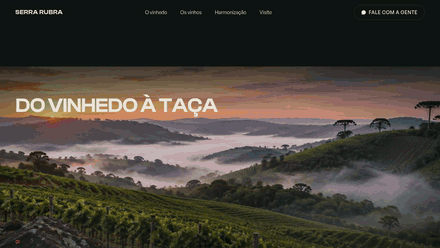
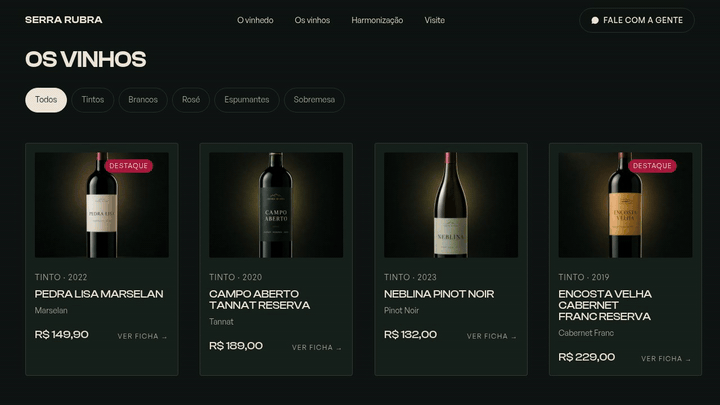
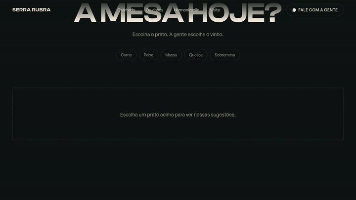

# 🍷 Serra Rubra

> **Projeto pessoal de estudos e portfólio, sem fins lucrativos.** A vinícola é fictícia e nada é vendido aqui.

Um site de uma página só para uma vinícola **fictícia** da serra gaúcha. Funciona como catálogo:
a pessoa conhece a vinícola, navega pelos vinhos e chama no WhatsApp. O foco é a
**experiência**: a página muda conforme a rolagem, tem uma garrafa em **3D feita em código**
e animações em todas as seções.

Feito com **PHP puro** no back-end e **HTML, CSS e JavaScript puros** no front-end, sem
frameworks, sem npm e sem bundler, organizado do jeito que um projeto profissional seria,
mas pensado para quem está aprendendo.

🔗 **Veja no ar:** [manoela-alves-silva.github.io/Catalogo-Vinicola](https://manoela-alves-silva.github.io/Catalogo-Vinicola/)

> No GitHub Pages não existe PHP, então a versão no ar roda em **modo estático**: o
> `frontend/js/api.js` lê o mesmo `vinhos.json` e aplica as mesmas regras da API
> (filtro por tipo e busca sem acento). No computador, o site continua usando a API PHP.



---

## 🎬 Demonstração

### Do vinhedo à taça
A seção fica presa na tela e a rolagem faz um "voo" pelas 6 etapas, do terroir ao engarrafamento.



### Catálogo
No desktop, a rolagem vertical anda com os vinhos na horizontal. O filtro por tipo reorganiza
os cards com animação, e cada vinho abre um painel com a ficha completa e o botão
"Quero este vinho", que leva ao WhatsApp com a mensagem pronta.



### Harmonização
A pessoa escolhe o prato e o site sugere os vinhos que combinam.



---

## 🚀 Como rodar

Precisa do **PHP 8+** e, para o front-end, do Live Server do VS Code **ou** do Python 3.

```bash
git clone https://github.com/manoela-alves-silva/Catalogo-Vinicola.git
cd Catalogo-Vinicola

# 1. API (porta 8000)
php -S localhost:8000 -t backend/public

# 2. Front-end (porta 5500), em outro terminal
#    Opção A: abrir a pasta frontend/ com o Live Server do VS Code
#    Opção B:
cd frontend && python3 -m http.server 5500
```

Abra **http://localhost:5500**.

> 💡 A porta 5500 importa: a API só libera o CORS para `localhost:5500` e `127.0.0.1:5500`
> (em `backend/public/index.php`).

As bibliotecas (Three.js, GSAP, Lenis) e as fontes vêm por CDN: não há nada para instalar.

---

## 🗂️ Estrutura (e o porquê de cada pasta)

```
vinicola/
├── backend/                 ← a API (o front só conversa com ela por HTTP)
│   ├── public/index.php     ← A ÚNICA parte que o navegador acessa: o roteador
│   ├── src/                 ← uma classe por arquivo
│   │   ├── Vinho.php        ← o modelo de um vinho
│   │   ├── Catalogo.php     ← lê, filtra e busca os vinhos
│   │   └── RespostaJson.php ← padroniza respostas e erros
│   └── dados/vinhos.json    ← os 10 vinhos fictícios
│
├── frontend/
│   ├── index.html           ← todo o conteúdo (legível mesmo sem JavaScript)
│   ├── css/                 ← um arquivo por área: base, layout, cabeçalho, hero, catálogo...
│   ├── js/                  ← um módulo por responsabilidade
│   │   ├── main.js          ← liga tudo, na ordem certa (e explica o porquê)
│   │   ├── preloader.js · rolagem.js · textos.js · cursor.js · menu.js
│   │   ├── vinhedo.js · catalogo.js · cardVinho.js · painelVinho.js · harmonizacao.js
│   │   └── cena3d/          ← a garrafa 3D (renderizador, garrafa, rótulo, luz, interação)
│   └── assets/img/          ← fotos dos vinhos, das etapas do vinhedo e da visita
│
└── docs/gifs/               ← os GIFs deste README
```

**Por que front e back separados?** O front não sabe de onde vêm os vinhos: ele só chama
`/api/vinhos`. Se amanhã a API mudar de linguagem, o site continua igual.

**Por que o `Catalogo` lê os dados num método só?** Hoje é um arquivo JSON. Para trocar
por um banco de dados, só esse método muda; o resto da API nem percebe.

**Por que tanto arquivo pequeno?** Cada arquivo tem uma responsabilidade e fica abaixo de
~200 linhas. Fica fácil achar as coisas e explicar cada parte.

### A API

| Método | Rota                 | O que retorna                                              |
|--------|----------------------|------------------------------------------------------------|
| GET    | `/api/vinhos`        | Lista de vinhos. Filtros: `?tipo=tinto&busca=reserva`      |
| GET    | `/api/vinhos/{slug}` | Um vinho com todos os detalhes                             |

Erros voltam com o código HTTP certo e uma mensagem em JSON:

```bash
curl "localhost:8000/api/vinhos?tipo=xyz"   # 400 → { "erro": "Tipo inválido: \"xyz\". Use um destes: ..." }
curl localhost:8000/api/vinhos/nao-existe   # 404 → { "erro": "Vinho \"nao-existe\" não encontrado." }
```

### Como a página "sobe"

O `main.js` liga os módulos numa ordem pensada, e cada passo tem um comentário explicando:

1. Conteúdo e links do WhatsApp (funciona até sem as bibliotecas)
2. Rolagem suave (Lenis) sincronizada com o ScrollTrigger
3. Preloader cobrindo a tela; cada etapa pronta faz o contador andar
4. Fontes carregadas → animações de texto (o SplitText precisa medir as linhas)
5. Garrafa 3D → vinhedo → a cortina sobe e o hero entra
6. Catálogo (vem da API) → harmonização → recalcula todas as posições

---

## ✨ Funcionalidades

**Experiência**
- Preloader com uma taça enchendo, que acompanha o carregamento **de verdade**
- Garrafa 3D feita com `LatheGeometry`: gira, inclina com o mouse, pode ser arrastada e tem luz que segue o cursor
- Rótulo da garrafa desenhado num canvas 2D, que vira textura no 3D
- Textos que entram letra por letra e um manifesto em que as palavras acendem com a rolagem
- Voo pelas fotos das etapas do vinho, preso na tela
- Catálogo com rolagem horizontal, filtro animado (GSAP Flip) e cards que inclinam no hover
- Painel lateral com a ficha completa e mensagem pronta para o WhatsApp
- Harmonização por prato
- Cursor personalizado (vira "Ver" nos cards e "Girar" na garrafa) e botões magnéticos

**Acessibilidade e celular**
- Todo o conteúdo está no HTML: **sem JavaScript, o site continua legível**
- Respeita o **`prefers-reduced-motion`**: sem rolagem suave, sem seções presas e com os textos aparecendo direto
- Filtros com `aria-pressed`, painel com foco preso e `Esc`, menu com `aria-expanded`
- Menu em tela cheia no celular e catálogo em lista vertical
- Toque na garrafa gira sem travar a rolagem (`touch-action: pan-y`)

**Se algo falhar, o site continua**
- Sem WebGL → a garrafa vira uma imagem estática
- CDN do GSAP fora do ar → site sem animações, mas completo
- Preloader com tempo limite (no JS e no CSS): nunca prende a página

**Desempenho**
- `pixelRatio` no máximo 2 e menos detalhes no celular
- A cena 3D pausa quando sai da tela
- Fotos com `srcset` e `loading="lazy"`
- Só `transform` e `opacity` são animados

---

## 📚 O que este projeto ensina

| Conceito                                   | Onde ver                                          |
|--------------------------------------------|---------------------------------------------------|
| POO em PHP, uma classe por arquivo         | `backend/src/`                                    |
| Roteador simples e códigos HTTP (400, 404) | `backend/public/index.php`                        |
| CORS                                       | `backend/public/index.php`                        |
| ES Modules e `import()` dinâmico           | `frontend/js/main.js`                             |
| `fetch` e tratamento de erros              | `frontend/js/api.js`                              |
| 3D com Three.js (geometria, luz, sombra)   | `frontend/js/cena3d/`                             |
| Animação guiada pela rolagem               | `frontend/js/vinhedo.js`, `frontend/js/catalogo.js` |
| Variáveis CSS e tipografia fluida (`clamp`) | `frontend/css/base.css`                          |
| Acessibilidade (ARIA, foco, reduced-motion) | `frontend/js/painelVinho.js`, `frontend/js/menu.js` |
| Melhoria progressiva (funciona sem JS)     | `frontend/js/sinalizarJs.js`, `frontend/css/animacoes.css` |

---

## ⚖️ Aviso

Este é um **projeto pessoal de estudos e portfólio, sem fins lucrativos**. A vinícola, os
vinhos, os preços, o endereço, o Instagram e o WhatsApp são **fictícios**. Não há loja,
venda nem pagamento.

As fotos foram **geradas por IA** e não mostram lugares nem produtos reais. A garrafa 3D é
feita inteiramente em código.

### Licença

O **código** está sob a [licença MIT](LICENSE): pode estudar, copiar e reaproveitar.

---

## 🔮 Próximas ideias

- [ ] Trocar o JSON por um banco de dados (só o método de leitura do `Catalogo` muda)
- [ ] Busca por nome no catálogo (a API já aceita `?busca=`)
- [ ] Versão em inglês
- [ ] Publicar o site (front estático + API PHP)
